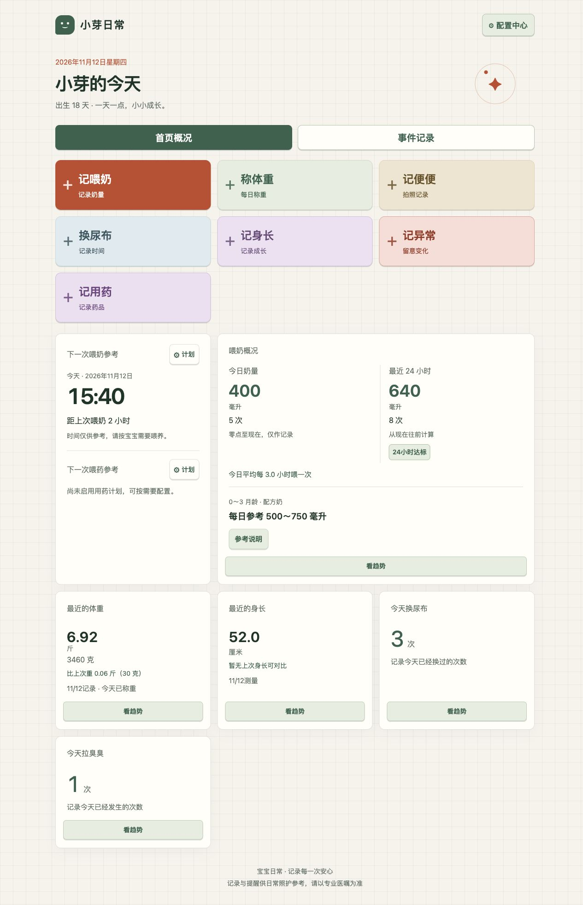
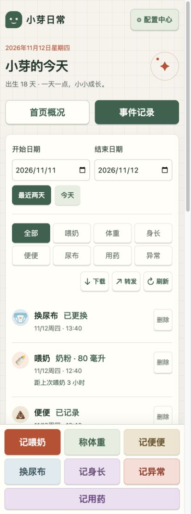

# 宝宝日常（Babycare）

支持 Docker 自部署的中文婴幼儿照护记录应用，涵盖新生儿喂奶与母乳记录、换尿布、便便、体重身长、用药计划及喂奶提醒，适合家庭、月嫂和长辈使用。

## 产品设计方向

产品优先照顾“拿起手机就要马上看懂”的人，尤其是年龄较大的照护者：

- 用日常说法，少用专业术语；每个提示先说该做什么，再补充原因。
- 字体、按钮和点击区域保持清楚、够大，重要操作不藏在难找的图标里。
- 首页先展示今天最需要知道的内容，记录入口固定、直接，减少层层跳转。
- 允许补记、修改和查看历史；日期、时间和单位尽量写完整，避免靠猜。
- 对喂奶、奶量和发育只做参考，不用“达标/不达标”制造压力；需要专业判断时明确提醒咨询医生。
- 手机端支持左右滑动切换页面，同时保留屏幕边缘的系统返回手势。

产品会持续更新。每次更新都从真实照护场景出发，优先解决“看不懂、找不到、记不下、容易误解”的问题，再增加新的功能。

## 环境要求

安装 Git、Docker 和 Docker Compose。使用 Docker Desktop 时已包含 Docker Compose。

## 初始化

```sh
git clone <仓库地址> babycare
cd babycare
cp .env.example .env
```

编辑 `.env`，将 `APP_PORT` 设置为本机未被占用的端口，例如：

```dotenv
APP_PORT=3000
```

保存后启动：

```sh
docker compose up -d --build
```

浏览器访问 `http://localhost:你配置的端口`。例如配置为 `3000`，访问 http://localhost:3000 。

首次进入后，打开“配置中心”填写宝宝信息并设置喂奶计划；需要记录用药时，可添加常用药品及单位，再配置用药计划。

首页的“参考资料”可查看疫苗路线、喂养参考和成长百分位表。填写生日后会高亮当前及下一个疫苗阶段；成长表还可按指标、性别和年龄段筛选。疫苗资料仅供查阅，接种状态和疫苗提醒留待后续版本。

数据库在首次启动时自动创建，无需单独安装或配置。数据保存在 Docker 数据卷 `o-w_babycare-data` 中，重建容器后仍会保留。

## 当前功能

- 喂奶记录：瓶喂奶量、母乳亲喂左右侧计时、暂停和补记。
- 首页喂奶概况：奶量和次数、平均喂奶间隔、月龄参考，以及喂奶当下的观察提示。
- 成长记录：体重、身长、前后变化、百分位趋势和营养状况参考。
- 日常照护：湿尿布、便便颜色和照片、异常情况、用药记录与用药计划。
- 发育观察：按月龄提供日常互动观察和官方资料参考，可保存观察结果。
- 参考资料：喂养、成长、发育和疫苗资料集中查看，保留来源链接。
- 事件记录：按日期和类别筛选、修改、删除和查看历史记录。

## 开发与验证

项目使用 Node.js 原生测试运行器：

```sh
npm test
```

提交前至少检查：

1. `npm test` 全部通过。
2. 手机宽度下首页、记录页和记喂奶页仍然容易阅读和操作。
3. 重要文案让不熟悉专业术语的人只读一遍就能明白。
4. 喂奶和成长提示仍然是参考，不替代医生诊断。

## 界面预览

以下截图均使用虚构演示数据。



| 手机记喂奶 | 手机事件记录 |
| --- | --- |
|  |  |

## 参考手册

应用中的成长记录和照护提示参考以下公开资料，链接均指向发布机构的原文或官方入口：

- 国家卫生健康委员会《国家基本公共卫生服务规范（第三版）》：[国家政府网通知](https://www.gov.cn/xinwen/2017-03/21/content_5179431.htm)，用于 0～6 岁儿童健康管理、体检和发育观察。
- 国家卫生健康委员会《婴幼儿营养喂养评估服务指南（试行）》：[官方原文](https://www.nhc.gov.cn/fys/c100078/202502/19903ff647694f3a85ed6fe332380b34.shtml)。每日奶量参考按过去24小时统计，使用满月、3、6、8、12、18～24月龄评估节点；应用为未满月宝宝沿用满月的600～700毫升参考，这不是指南对出生起的统一要求；指南没有给出24月龄后的固定毫升范围。
- 国家卫生健康委员会 WS/T 423—2022《7 岁以下儿童生长标准》：[公告页](https://www.nhc.gov.cn/fzs/c100048/202211/5001d7cf57774770a1d49c1df46a291f.shtml) · [官方 PDF](https://www.nhc.gov.cn/fzs/c100048/202211/5001d7cf57774770a1d49c1df46a291f/files/1733125082501_81468.pdf)。成长记录按第4.1节及附录A显示百分位生长水平；胖瘦为应用依据体重指数百分位提供的参考提示，不输出营养诊断分级；[算法与适用边界](docs/growth-assessment.md)。
- 美国儿科学会（AAP）预防保健体检日程：[官方 PDF](https://downloads.aap.org/AAP/PDF/periodicity_schedule.pdf)。
- 世界卫生组织（WHO）儿童生长标准：[身长/身高别年龄官方入口](https://www.who.int/tools/child-growth-standards/standards/length-height-for-age)。
- 美国疾病控制与预防中心（CDC）发育里程碑清单：[官方入口](https://www.cdc.gov/act-early/milestones/index.html)。
- 疫苗资料：项目内的[儿童免疫程序表电子化版本](docs/vaccination-schedule.md)和[结构化数据](docs/vaccination-schedule.json)来自用户提供的门诊纸质表照片；它们保留照片中的价格和简称，在参考资料页只读展示，并作为后续疫苗计划功能的初始资料，不代表当前全国统一标准。

这些资料用于日常记录和趋势观察，不能替代医生诊断、体检或个体化照护建议。

## 持续更新

更新记录见项目内的[更新日志](更新日志.md)。每次发布会优先记录影响日常使用的界面变化、数据兼容性和验证结果；如果某项功能仍只是参考资料展示，也会在页面和文档中明确说明。
