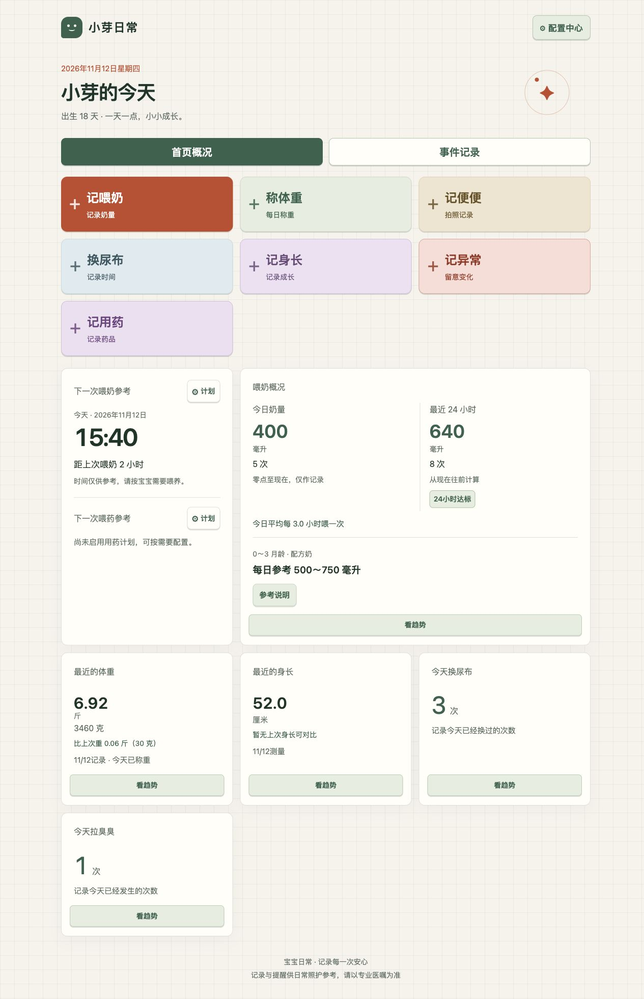
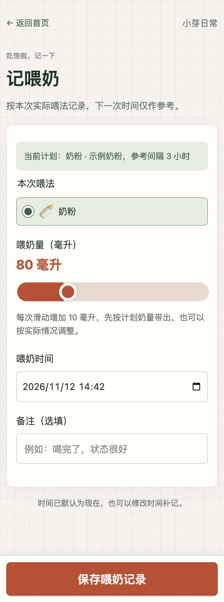
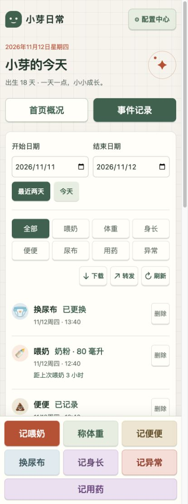

# 宝宝日常（Babycare）

支持 Docker 自部署的中文婴幼儿照护记录应用，涵盖新生儿喂奶与母乳记录、换尿布、便便、体重身长、用药计划及喂奶提醒，适合家庭、月嫂和长辈使用。

## 环境要求

安装 Git、Docker 和 Docker Compose。使用 Docker Desktop 时已包含 Docker Compose。

## 初始化

```sh
git clone <仓库地址> babycare
cd babycare
cp .env.example .env
```

编辑 `.env`，将 `APP_PORT` 设置为本机未被占用的端口，例如：

```dotenv
APP_PORT=3000
```

保存后启动：

```sh
docker compose up -d --build
```

浏览器访问 `http://localhost:你配置的端口`。例如配置为 `3000`，访问 http://localhost:3000 。

首次进入后，打开“配置中心”填写宝宝信息并设置喂奶计划；需要记录用药时，可添加常用药品及单位，再配置用药计划。

数据库在首次启动时自动创建，无需单独安装或配置。数据保存在 Docker 数据卷 `o-w_babycare-data` 中，重建容器后仍会保留。

## 界面预览

以下截图均使用虚构演示数据。



| 手机记喂奶 | 手机事件记录 |
| --- | --- |
|  |  |
